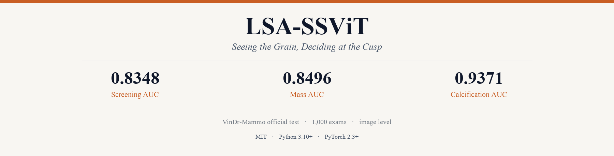
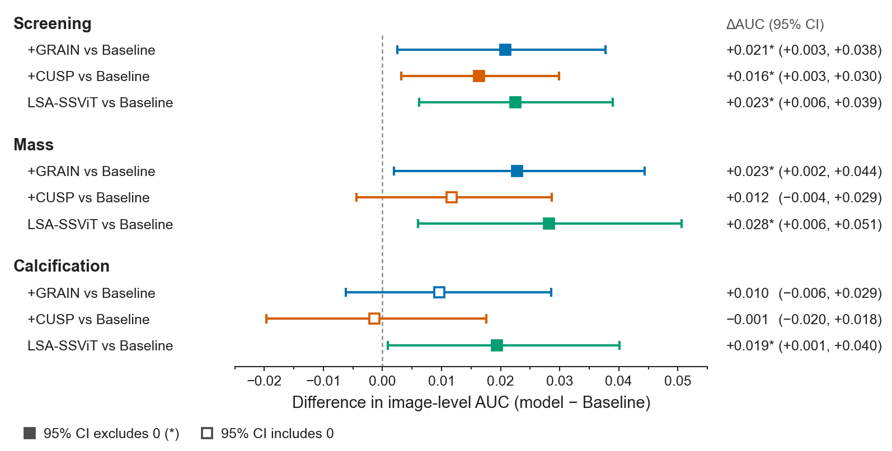
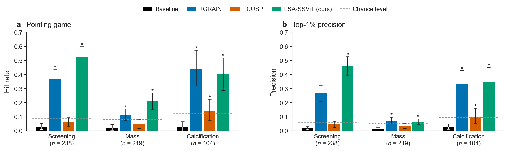
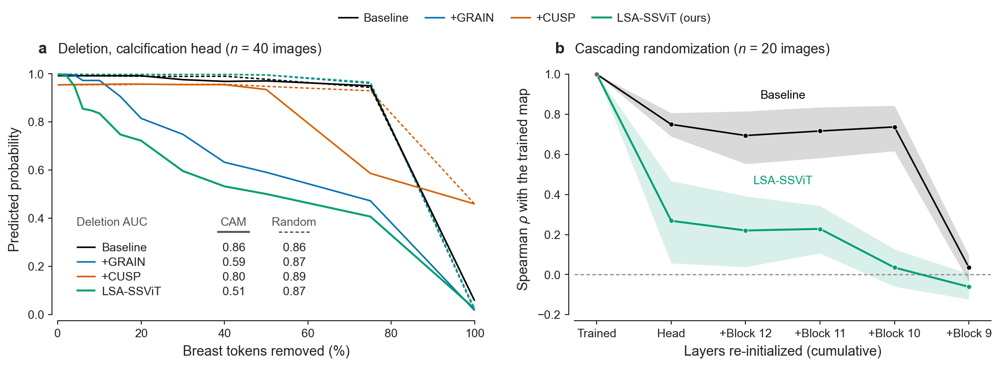

<p align="center">
  <picture>
    <source media="(prefers-color-scheme: dark)" srcset="assets/readme_header_dark.png">
    
  </picture>
</p>

<p align="center">
  <a href="https://huggingface.co/facebook/dinov3-vitb16-pretrain-lvd1689m"></a>
  <a href="#data"></a>
  <a href="#quick-start"></a>
  <a href="LICENSE"></a>
</p>

This repository is the official implementation of **Seeing the Grain, Deciding at the Cusp: Lesion-Scale and Clinically Guided Adaptation of a Vision Foundation Model for Multi-task Mammography Screening**.

LSA-SSViT adapts a DINOv3 ViT-B/16 backbone at 1024 × 1024 with [GRAIN](#grain) and [CUSP](#cusp). From one image it predicts a BI-RADS screening decision (BI-RADS 3–5 vs 1–2), whether a mass is present, and whether suspicious calcifications are present.

> [!NOTE]
> This repository contains the training and evaluation code, the exam-level split, and the predictions behind the tables and plots. Pre-trained checkpoints are available on [Google Drive](#pre-trained-models); no mammogram images are included.

<p align="center">
  <a href="#quick-start">Quick Start</a> &nbsp;·&nbsp;
  <a href="#requirements">Requirements</a> &nbsp;·&nbsp;
  <a href="#training">Training</a> &nbsp;·&nbsp;
  <a href="#evaluation">Evaluation</a> &nbsp;·&nbsp;
  <a href="#pre-trained-models">Pre-trained models</a> &nbsp;·&nbsp;
  <a href="#results">Results</a> &nbsp;·&nbsp;
  <a href="#method">Method</a> &nbsp;·&nbsp;
  <a href="#data">Data</a> &nbsp;·&nbsp;
  <a href="#comparator-networks">Comparators</a> &nbsp;·&nbsp;
  <a href="#heat-maps">Heat maps</a> &nbsp;·&nbsp;
  <a href="#citation">Citation</a>
</p>

## Quick Start

Reproduce every table and statistical plot of the paper from the released predictions, with no GPU, no checkpoint and no mammograms:

```bash
git clone https://github.com/3xiaoshayu/LSA-SSViT.git
cd LSA-SSViT
pip install numpy pandas scikit-learn matplotlib
python scripts/paper_tables.py    # writes results/summary.json and results/paper_tables.md
python scripts/plot_figures.py    # writes figures/*.pdf and figures/*.png
python scripts/plot_heatmaps.py   # writes localization and faithfulness figures
```

The whole-model comparison (`python comparators/summarize.py`) additionally imports PyTorch; a CPU build is enough.

## Requirements

Python 3.10 or newer. Install PyTorch 2.3 or newer (with CUDA for training) following [pytorch.org](https://pytorch.org/get-started/locally/), then

```bash
pip install -r requirements.txt
```

The code was tested with Python 3.12, PyTorch 2.8 and transformers 5.13–5.17.

The pretrained backbone is [`facebook/dinov3-vitb16-pretrain-lvd1689m`](https://huggingface.co/facebook/dinov3-vitb16-pretrain-lvd1689m). It is a gated model: accept its license on Hugging Face and log in (`hf auth login`), or download it and pass the local folder with `--backbone`. It is only needed for training; evaluating a released checkpoint needs no download of the backbone.

The datasets are not included. How to obtain VinDr-Mammo and INbreast, and the split used in the paper, is in [Data](#data).

## Training

Build the preprocessing cache, then train the four models of the paper:

```bash
python scripts/build_cache.py --image-root /path/to/vindr-mammo/images --cache-root outputs/cache/vindr_1024

python train.py --cache-root outputs/cache/vindr_1024 --experiment-name baseline
python train.py --cache-root outputs/cache/vindr_1024 --experiment-name grain      --grain
python train.py --cache-root outputs/cache/vindr_1024 --experiment-name cusp       --cusp
python train.py --cache-root outputs/cache/vindr_1024 --experiment-name LSA-SSViT --grain --cusp
```

`--image-root` is the folder that contains one sub-folder per exam (`<study_id>/<image_id>.dicom`). What the cache contains is described in [Preprocessing](#preprocessing). `train.py` and `evaluate.py` can also preprocess on the fly with `--image-root`, which differs from the cache only by the uint16 rounding (about 7.6e-6 per pixel).

<details>
<summary>Settings used in the paper</summary>

| Setting | Value used in the paper |
| --- | --- |
| Optimizer | AdamW, weight decay 1e-4 |
| Learning rate | 2e-4 for the classifier and GRAIN; 1e-4 for the last four backbone blocks and the final LayerNorm. The rest of the backbone is frozen. |
| Batch size | 8 |
| Schedule | at most 20 epochs, cosine decay |
| Early stopping | patience of 6 epochs on the validation screening AUC |
| Dropout | 0.25 before the classifier |
| Class weights | positive weight equal to the negative-to-positive ratio of the training split, capped at 20 |
| Augmentation | horizontal flipping; random affine (scale 0.9–1.1, rotation ±10°, translation ±5%); contrast and brightness jitter |
| Precision | mixed precision; the four GRAIN-equipped blocks are computed in FP32 |
| Seed | 2026 |
| Hardware | a GPU with at least 24 GB of memory |

</details>

Each run writes `outputs/runs/<name>/best.pt` (best validation screening AUC), `last.pt` (for `--resume`), `history.csv`, `train.log`, `run.json`, and the validation and held-out predictions.

## Evaluation

### Reproduce the released tables

No GPU and no checkpoint. These scripts read only the released files in `results/`.

```bash
python scripts/paper_tables.py    # writes results/summary.json and results/paper_tables.md
python scripts/plot_figures.py    # writes figures/*.pdf and figures/*.png
python scripts/plot_heatmaps.py   # localization and faithfulness figures from results/heatmaps/
python comparators/summarize.py   # whole-model comparison: results/comparators/comparison_tables.md
```

The two figures of heat maps also need the images and the maps (see [Heat maps](#heat-maps)). `figures/` is written locally and is not part of this repository.

### Evaluate a checkpoint

Download the weights from [Pre-trained models](#pre-trained-models) to `checkpoints/<model>/best.pt`. Thresholds are selected on the validation split with Youden's index and applied unchanged to the test split. Run the following for each model:

```bash
python evaluate.py --checkpoint checkpoints/LSA-SSViT/best.pt --cache-root outputs/cache/vindr_1024 \
    --output-dir outputs/eval/LSA-SSViT
```

The script writes `metrics_test.json` (image-, breast- and exam-level metrics, sensitivity at 90% specificity, specificity at 90% sensitivity) and `predictions_test.csv`. The files in `results/vindr/` were produced this way. A checkpoint you trained yourself (`outputs/runs/<name>/best.pt`) is evaluated with the same command.

### External test on INbreast

```bash
python scripts/prepare_inbreast.py --xls /path/to/INbreast.xls --dicom-dir /path/to/AllDICOMs
python scripts/evaluate_inbreast.py --image-root /path/to/AllDICOMs --output-root outputs/inbreast
```

The predictions released with the paper are already in `results/inbreast/`, and `python scripts/paper_tables.py` reads those. The command above writes a new run to `outputs/inbreast/` and does not replace them.

By default, `evaluate_inbreast.py` reads the four checkpoints from `checkpoints/<model>/best.pt` (`--checkpoint-root checkpoints`). The VinDr-trained checkpoints are applied without fine-tuning or recalibration. The screening label follows the same BI-RADS rule (first digit ≥ 3, including 4a–4c and 6); the INbreast mass and microcalcification annotations include benign findings. Confidence intervals resample patients.

## Pre-trained models

The four trained checkpoints from the paper are available in the shared Google Drive folder [`LSA-SSViT-checkpoints`](https://drive.google.com/drive/folders/1OQNJXwMuR2FxY5KVvWTZg9M3YVGO0rZT):

| Model | Local path | Size | Download | SHA256 (prefix) |
| --- | --- | ---: | --- | --- |
| Baseline | `checkpoints/baseline/best.pt` | 326.8 MiB | [`baseline_best.pt`](https://drive.google.com/file/d/1426LrhPN1dErfIk_3fIxm3hNR5sFrJkw/view?usp=sharing) | `b4f0703e` |
| +GRAIN | `checkpoints/grain/best.pt` | 336.4 MiB | [`grain_best.pt`](https://drive.google.com/file/d/1WLZ8zGFbcfpIx40nqETqI0kbfvrZmIL9/view?usp=sharing) | `16000a3d` |
| +CUSP | `checkpoints/cusp/best.pt` | 326.8 MiB | [`cusp_best.pt`](https://drive.google.com/file/d/1-PfX53MDl2N_yvKXBPNK_gp_QIcVj2P_/view?usp=sharing) | `6db07d8d` |
| **LSA-SSViT** | `checkpoints/LSA-SSViT/best.pt` | 336.4 MiB | [`LSA-SSViT_best.pt`](https://drive.google.com/file/d/1ZpBXadif42tY1HWd1vIfB0DaY-1rc_lt/view?usp=sharing) | `bb703f63` |

On Google Drive each file carries its model prefix so all four live in one folder; rename each downloaded file to `best.pt` at its local path above (`scripts/evaluate_inbreast.py`, `scripts/heatmaps.py`, and [`SHA256SUMS.txt`](SHA256SUMS.txt) read `checkpoints/<model>/best.pt` by default, while `evaluate.py` and `scripts/model_complexity.py` take any path via `--checkpoint`). Verify checksums against [`SHA256SUMS.txt`](SHA256SUMS.txt). Each file stores FP32 model weights only (no optimizer state; 85.66 M parameters for Baseline / +CUSP and 88.17 M with GRAIN), along with the backbone and preprocessing configuration, and loads via `weights_only=True` without downloading from Hugging Face.

<details>
<summary>Download via CLI with gdown</summary>

```bash
pip install -U gdown
mkdir -p checkpoints/baseline checkpoints/grain
mkdir -p checkpoints/cusp checkpoints/LSA-SSViT

gdown 1426LrhPN1dErfIk_3fIxm3hNR5sFrJkw -O checkpoints/baseline/best.pt
gdown 1WLZ8zGFbcfpIx40nqETqI0kbfvrZmIL9 -O checkpoints/grain/best.pt
gdown 1-PfX53MDl2N_yvKXBPNK_gp_QIcVj2P_ -O checkpoints/cusp/best.pt
gdown 1ZpBXadif42tY1HWd1vIfB0DaY-1rc_lt -O checkpoints/LSA-SSViT/best.pt

# Verify all four checkpoints (or grep LSA-SSViT for a single model)
grep checkpoints/ SHA256SUMS.txt | sha256sum -c -
```

</details>

> [!IMPORTANT]
> Because each file exceeds GitHub's 100 MB limit, checkpoints are hosted on [Google Drive](https://drive.google.com/drive/folders/1OQNJXwMuR2FxY5KVvWTZg9M3YVGO0rZT) alongside [`DINOv3_LICENSE.md`](https://drive.google.com/file/d/1L5S0Ckg-74ak4hK_QjrfgNUEn6_DIzuY/view?usp=sharing) and [`README_WEIGHTS.txt`](https://drive.google.com/file/d/1hdJhzSa4CvRab7SHtrRBnN7o5f_mcy-6/view?usp=sharing). All four checkpoints contain weights derived from DINOv3 and are distributed for research use under the [DINOv3 License](https://ai.meta.com/resources/models-and-libraries/dinov3-license/) (see [License](#license)).

## Results

### Ablation on VinDr-Mammo

Official VinDr-Mammo test split (1,000 exams, 4,000 images), image level. Confidence intervals come from 2,000 bootstrap replicates over exams; `*` marks a paired AUC difference versus the Baseline whose 95% CI excludes 0. Reproduce these tables with the first command in [Evaluation](#evaluation).

<p align="center">
  <picture>
    <source media="(prefers-color-scheme: dark)" srcset="assets/ablation_forest_plot_dark.png">
    
  </picture>
</p>

| Model | GRAIN | CUSP | Screening AUC | Screening AP | Mass AUC | Mass AP | Calcification AUC | Calcification AP |
| --- | :---: | :---: | ---: | ---: | ---: | ---: | ---: | ---: |
| Baseline | | | 0.8123 | 0.526 | 0.8215 | 0.291 | 0.9176 | 0.686 |
| +GRAIN | ✓ | | 0.8331\* | **0.552** | 0.8442\* | 0.448 | 0.9272 | 0.705 |
| +CUSP | | ✓ | 0.8286\* | 0.542 | 0.8332 | 0.347 | 0.9163 | 0.642 |
| **LSA-SSViT** | ✓ | ✓ | **0.8348**\* | 0.548 | **0.8496**\* | **0.464** | **0.9371**\* | **0.723** |

<details>
<summary>Per-task tables with 95% confidence intervals and paired ΔAUC</summary>

**Screening**

| Model | AUC (95% CI) | ΔAUC vs Baseline (95% CI) | AP | Sens. at 90% Spec. | Spec. at 90% Sens. |
| --- | ---: | ---: | ---: | ---: | ---: |
| Baseline | 0.8123 (0.7810–0.8442) | — | 0.526 | 56.0% | 39.1% |
| +GRAIN | 0.8331 (0.8033–0.8624) | +0.0208 (+0.0025, +0.0377)\* | **0.552** | 57.8% | 45.3% |
| +CUSP | 0.8286 (0.7987–0.8583) | +0.0163 (+0.0032, +0.0299)\* | 0.542 | 57.3% | 45.3% |
| **LSA-SSViT** | **0.8348** (0.8058–0.8632) | **+0.0225** (+0.0063, +0.0390)\* | 0.548 | **58.9%** | **49.6%** |

**Mass**

| Model | AUC (95% CI) | ΔAUC vs Baseline (95% CI) | AP | Sens. at 90% Spec. | Spec. at 90% Sens. |
| --- | ---: | ---: | ---: | ---: | ---: |
| Baseline | 0.8215 (0.7826–0.8570) | — | 0.291 | 57.1% | 45.6% |
| +GRAIN | 0.8442 (0.8091–0.8788) | +0.0228 (+0.0019, +0.0444)\* | 0.448 | 58.9% | 48.1% |
| +CUSP | 0.8332 (0.7961–0.8677) | +0.0117 (−0.0044, +0.0286) | 0.347 | 59.4% | **50.8%** |
| **LSA-SSViT** | **0.8496** (0.8147–0.8825) | **+0.0282** (+0.0060, +0.0506)\* | **0.464** | **61.6%** | 49.6% |

**Calcification**

| Model | AUC (95% CI) | ΔAUC vs Baseline (95% CI) | AP | Sens. at 90% Spec. | Spec. at 90% Sens. |
| --- | ---: | ---: | ---: | ---: | ---: |
| Baseline | 0.9176 (0.8688–0.9596) | — | 0.686 | 82.9% | 70.4% |
| +GRAIN | 0.9272 (0.8796–0.9672) | +0.0096 (−0.0062, +0.0286) | 0.705 | 83.8% | 69.0% |
| +CUSP | 0.9163 (0.8692–0.9577) | −0.0013 (−0.0197, +0.0176) | 0.642 | 79.0% | 66.6% |
| **LSA-SSViT** | **0.9371** (0.8945–0.9726) | **+0.0194** (+0.0009, +0.0401)\* | **0.723** | **84.8%** | **73.6%** |

</details>

### External test on INbreast (no fine-tuning)

VinDr-Mammo checkpoints applied directly to INbreast (108 patients, 410 images) without fine-tuning or recalibration; 95% CIs resample patients:

| Model | Screening AUC (95% CI) | ΔAUC vs Baseline (95% CI) | Screening AP | Mass AUC | Mass AP | Calcification AUC | Calcification AP |
| --- | ---: | ---: | ---: | ---: | ---: | ---: | ---: |
| Baseline | 0.8174 (0.7484–0.8834) | — | 0.698 | 0.7577 | 0.512 | 0.6988 | 0.863 |
| +GRAIN | **0.8628** (0.7982–0.9219) | +0.0454 (+0.0169, +0.0780)\* | **0.765** | 0.8735 | 0.797 | 0.7070 | 0.871 |
| +CUSP | 0.8409 (0.7740–0.9039) | +0.0235 (+0.0034, +0.0432)\* | 0.712 | 0.7940 | 0.601 | 0.6825 | 0.854 |
| **LSA-SSViT** | 0.8605 (0.7970–0.9179) | +0.0431 (+0.0185, +0.0698)\* | 0.757 | **0.8757** | **0.813** | **0.7078** | **0.874** |

<details>
<summary>Comparison with 9 networks trained under the same protocol (VinDr-Mammo test split)</summary>

Here `*` indicates that the 95% CI of the paired AUC difference `AUC(LSA-SSViT) − AUC(network)` excludes 0:

| Network | Family | Screening AUC | Screening AP | Mass AUC | Mass AP | Calcification AUC | Calcification AP |
| --- | --- | ---: | ---: | ---: | ---: | ---: | ---: |
| ResNet-50 | CNN | 0.7898\* | 0.491 | 0.7946\* | 0.359 | 0.9287 | 0.686 |
| EfficientNet-B3 | CNN | 0.8088\* | 0.531 | 0.8110\* | 0.399 | 0.9347 | 0.683 |
| ConvNeXt-T | CNN | 0.7973\* | 0.473 | 0.8002\* | 0.339 | 0.9163 | 0.518 |
| MobileNetV4-Conv-M | CNN | 0.7848\* | 0.459 | 0.8110\* | 0.360 | 0.8792\* | 0.519 |
| RoPE-ViT-B/16 | Transformer | 0.8253 | 0.528 | 0.8369 | 0.449 | 0.9364 | 0.683 |
| MambaVision-T | Hybrid | 0.8007\* | 0.503 | 0.8136\* | 0.371 | 0.9257 | 0.691 |
| DINOv2-B/14 | Foundation model | 0.7800\* | 0.409 | 0.7779\* | 0.235 | 0.9075 | 0.376 |
| RAD-DINO | Medical foundation model | 0.7759\* | 0.432 | 0.7924\* | 0.354 | 0.8800\* | 0.523 |
| Mammo-CLIP (EfficientNet-B2) | Mammography foundation model | 0.8226 | 0.526 | 0.8444 | 0.419 | 0.9155 | 0.629 |
| Baseline (DINOv3-B/16) | Ours, without GRAIN & CUSP | 0.8123\* | 0.526 | 0.8215\* | 0.291 | 0.9176\* | 0.686 |
| **LSA-SSViT** | **Ours** | **0.8348** | **0.548** | **0.8496** | **0.464** | **0.9371** | **0.723** |

Full confidence intervals and paired differences are in [`results/comparators/comparison_tables.md`](results/comparators/comparison_tables.md).

</details>

All tables of the paper, including validation-selected operating points and exam-level AUCs, are in [`results/paper_tables.md`](results/paper_tables.md). The whole-model comparison is in [`results/comparators/comparison_tables.md`](results/comparators/comparison_tables.md).

## Method

### Overview

```text
1024 × 1024 mammogram (1 channel, repeated to 3)
  │
  ├─ Patch embedding (16 × 16) + 2-D RoPE .. 64 × 64 = 4,096 tokens
  ├─ Blocks 1–8 ............................ frozen
  ├─ Block 9  → GRAIN ┐
  ├─ Block 10 → GRAIN │ .................... fine-tuned blocks,
  ├─ Block 11 → GRAIN │                      GRAIN computed in FP32
  ├─ Block 12 → GRAIN ┘
  ├─ LayerNorm → mean of patch tokens → dropout → linear head
  │                                          ├─ screening (BI-RADS 3–5)
  │                                          ├─ mass
  │                                          └─ suspicious calcification
  └─ Training only: L = L_BCE + 0.3·L_CU + 0.1·L_PC  (CUSP; train only)
```

### GRAIN

**Gated Residual Aggregation of Inter-token Neighborhoods** follows each of the last four transformer blocks (blocks 9–12). It reshapes the $N = 4{,}096$ patch tokens onto their $64 \times 64$ spatial grid, aggregates every token's $7 \times 7$ neighbourhood ($112 \times 112\text{ px}$ on the input) with a depthwise convolution $\text{DW}$, mixes channels with a $1 \times 1$ pointwise convolution $\text{PW}$, and adds the result back through a zero-initialised bounded gate:

$$
X' = X + \alpha \tanh(g)\tanh\big(\text{PW}(\text{DW}(X))\big), \qquad \alpha = 0.1,\quad g_0 = 0
$$

With $g_0 = 0$, each module is an exact identity mapping at initialization, leaving the pretrained backbone unaltered at step 0 while bounding the magnitude of any local correction to $|X' - X| < 0.1$. Prefix tokens (class and 4 register tokens) bypass GRAIN. Across the four modules, GRAIN adds $4 \times (49 C + C^2 + 1) = 2{,}509{,}828$ parameters (+2.93%).

### CUSP

**Clinically-guided, Uncertainty-weighted Supervision with Profile consistency** adds two training-only terms to the class-balanced binary cross-entropy loss:

$$
\mathcal{L} = \mathcal{L}_{\text{BCE}} + \lambda_1 \mathcal{L}_{\text{CU}} + \lambda_2 \mathcal{L}_{\text{PC}}, \qquad \lambda_1 = 0.3,\quad \lambda_2 = 0.1
$$

- **Clinically guided uncertainty weighting ($\mathcal{L}_{\text{CU}}$):** weights the mean class-balanced BCE of each image $i$ by the product of a clinical BI-RADS prior $\pi(b_i)$ — with $\pi(b) = (1.0, 1.2, \mathbf{2.0}, 1.4, 1.2)$ for BI-RADS $b \in \lbrace 1, 2, 3, 4, 5 \rbrace$, peaking at the BI-RADS 3 recall boundary — and the detached predictive ambiguity $a_{ik} = 1 - |2\text{sg}(p_{ik}) - 1|$:

$$
\mathcal{L}_{\text{CU}} = \frac{1}{B}\sum_{i=1}^{B} \pi(b_i)\bar{a}_i\overline{\text{BCE}}_i, \qquad \bar{a}_i = \frac{1}{3}\sum_{k=1}^{3} a_{ik}
$$

- **Label-profile consistency ($\mathcal{L}_{\text{PC}}$):** a soft-margin triplet loss ($\delta = 0.2$) on the $\ell_2$-normalised pooled features $e_i = f_i / \lVert f_i \rVert_2$ that pulls each anchor towards the nearest in-batch image sharing the same 3-label profile $c_i \in \lbrace 0, 1 \rbrace^3$ and pushes it away from the nearest image with a different profile:

$$
\mathcal{L}_{\text{PC}} = \frac{1}{|\mathcal{A}|}\sum_{i \in \mathcal{A}} \text{softplus}\left(d_i^+ - d_i^- + \delta\right)
$$

Both terms are active only during training; inference parameters and compute are identical to the Baseline. GRAIN is implemented in `core.py` (class `GRAIN`, used by `BreastClassifier`) and CUSP in `core.py` (function `cusp_loss`, used by `train.py`).

## Repository layout

The four models (Baseline, +GRAIN, +CUSP and LSA-SSViT) are called `baseline`, `grain`, `cusp` and `LSA-SSViT` in file and folder names. `figures/` and `paper/` are not part of this repository. The plotting scripts write `figures/` locally, and the figure legends are in the paper.

### Code

| Path | Contents |
| --- | --- |
| `core.py` | preprocessing, cache, dataset, model (DINOv3 + GRAIN), CUSP loss |
| `metrics.py` | label definitions, metrics, bootstrap |
| `train.py` | training of the four models |
| `evaluate.py` | evaluation of a checkpoint |
| `requirements.txt` | Python dependencies |
| `SHA256SUMS.txt` | checksums of released results and of the four checkpoints |
| `CITATION.cff` | citation metadata for GitHub's *Cite this repository* widget |
| `LICENSE` | MIT License |
| `assets/` | light and dark header banners and result plots for this page (`*_dark.png` for dark mode) |

### Scripts

| Path | Contents |
| --- | --- |
| `scripts/build_cache.py` | preprocessing cache for VinDr-Mammo |
| `scripts/paper_tables.py` | all tables of the paper from the released predictions |
| `scripts/plot_figures.py` | result figures of the paper |
| `scripts/prepare_inbreast.py` | INbreast manifest |
| `scripts/evaluate_inbreast.py` | external test on INbreast, no fine-tuning |
| `scripts/model_complexity.py` | parameters and MACs with and without GRAIN |
| `scripts/heatmaps.py` | class activation maps, Grad-CAM, localization, faithfulness |
| `scripts/plot_heatmaps.py` | heat-map figures of the paper |
| `scripts/figure_style.py` | shared figure style |
| `comparators/zoo.py` | comparator networks |
| `comparators/train_comparator.py` | re-training and evaluation of a comparator |
| `comparators/prepare_weights.py` | download of the comparators' pretrained weights |
| `comparators/summarize.py` | whole-model comparison table |

### Released files

| Path | Contents |
| --- | --- |
| `splits/vindr/` | exam-level split of VinDr-Mammo used in the paper |
| `checkpoints/<model>/` | target directory for downloaded weights (`best.pt`; hosted on [Google Drive](#pre-trained-models)) |
| `results/vindr/<model>/` | per-image test predictions and metrics |
| `results/inbreast/<model>/` | per-image predictions on INbreast, no fine-tuning |
| `results/heatmaps/` | lesion masks and heat-map results |
| `results/comparators/<model>/` | comparator predictions and training records |
| `results/comparators/comparison_tables.md` | whole-model comparison table |
| `results/summary.json` | numbers behind the tables and result figures |

## Data

**VinDr-Mammo.** Request access on [PhysioNet](https://physionet.org/content/vindr-mammo/) and download the DICOM files. The official training split (4,000 exams) is divided at the exam level, stratified by label profile, into 3,200 training, 400 validation and 400 held-out exams; the official test split (1,000 exams) is used only for the final evaluation. The split files in `splits/vindr/` list every image with its labels:

- screening: `breast_birads` is BI-RADS 3, 4 or 5 (read per breast, assigned to each view);
- mass: the image has a *Mass* finding;
- calcification: the image has a *Suspicious Calcification* finding.

`splits/vindr/study_split.csv` gives the split and stratum of every exam.

**INbreast** (external test only). Request the dataset from its authors; `scripts/prepare_inbreast.py` expects `INbreast.xls` and the DICOM folder.

## Preprocessing

Every image is decoded with its DICOM VOI LUT, constant padding bands along the border are removed, the breast is segmented without any annotation, disconnected fragments are removed, and the image is cropped to the breast (2% margin), resized to 1,024 pixels on the long side and zero-padded to 1024 × 1024. The result is cached once as uint16:

```bash
python scripts/build_cache.py --image-root /path/to/vindr-mammo/images --cache-root outputs/cache/vindr_1024
```

The paper's models were trained and evaluated from this cache.

## Comparator networks

`comparators/` re-trains other networks with exactly the protocol of `train.py`: the same splits, preprocessing, augmentation, three-head linear classifier (dropout 0.25), class-balanced BCE, optimizer, schedule, early stopping and validation-selected thresholds. The network-specific settings (pretrained weights, input normalisation, trained parameters, backbone learning rate and autocast precision) are listed in `comparators/zoo.py`.

```bash
pip install -r comparators/requirements.txt
python comparators/prepare_weights.py
python comparators/train_comparator.py --model resnet50 --cache-root outputs/cache/vindr_1024
python comparators/summarize.py --runs-root outputs/comparators
```

Each run trains on VinDr-Mammo, keeps the checkpoint with the best validation screening AUC, selects thresholds on the validation split, and evaluates the held-out and the official test split. It writes `outputs/comparators/<model>/` with the same files as `train.py`, plus `predictions_test.csv` and `metrics_test.json`. `comparators/summarize.py` builds the comparison table from these predictions and the released predictions of the Baseline and of LSA-SSViT: AUC (95% CI) and AP of every head, and the paired AUC difference of LSA-SSViT minus each network.

The test predictions and training records of the comparators reported in the paper are in `results/comparators/`, so `python comparators/summarize.py` reproduces the table (`results/comparators/comparison_tables.md`) without a GPU. The pretrained weights are downloaded from their sources and are not redistributed. Mammo-CLIP weights are licensed by their authors under CC BY-NC-SA 4.0.

## Model size and compute

```bash
python scripts/model_complexity.py --checkpoint checkpoints/LSA-SSViT/best.pt
```

GRAIN adds 4 × (49·768 + 768² + 1) = 2,509,828 parameters, which is 2.93% of the 85.66 M backbone parameters.

| | Without GRAIN | With GRAIN |
| --- | ---: | ---: |
| Parameters | 85.66 M backbone | +2,509,828 (2.93%) |
| Multiply-accumulates per 1024 × 1024 image | 660.7 G | 671.0 G (+10.28 G, +1.56%) |

## Heat maps

Each head is a linear layer applied to the mean of the final patch tokens $z_{u,v} \in \mathbb{R}^{768}$ on the $64 \times 64$ grid ($N = 4{,}096$), so its logit is an exact spatial decomposition with no gradient and no post-hoc approximation:

$$
\ell_k = \beta_k + \frac{1}{N}\sum_{u,v} w_k^\top z_{u,v}, \qquad M_k(u,v) = w_k^\top z_{u,v}
$$

### Weakly supervised lesion localization

Pointing game (fraction of images whose map maximum lies within 15 pixels of a radiologist-annotated lesion) and top-1% precision (share of the 1% highest-scoring breast pixels inside a lesion) on the official VinDr-Mammo test split. Lesion annotations were never used during training.

<p align="center">
  <picture>
    <source media="(prefers-color-scheme: dark)" srcset="assets/heatmap_localization_dark.png">
    
  </picture>
</p>

| Model | Screening PG ($n=238$) | Screening Top-1% | Mass PG ($n=219$) | Mass Top-1% | Calcification PG ($n=104$) | Calcification Top-1% |
| --- | ---: | ---: | ---: | ---: | ---: | ---: |
| Baseline | 0.029 | 0.018 | 0.023 | 0.014 | 0.029 | 0.029 |
| +GRAIN | 0.366\* | 0.265\* | 0.114\* | **0.072**\* | **0.442**\* | 0.332\* |
| +CUSP | 0.063 | 0.045 | 0.046 | 0.035 | 0.144\* | 0.101\* |
| **LSA-SSViT** | **0.525**\* | **0.460**\* | **0.210**\* | 0.065\* | 0.404\* | **0.344**\* |
| Chance | 0.088 | 0.061 | 0.080 | 0.053 | 0.124 | 0.095 |

On the external **INbreast** test set ($n = 110$ images with lesion contours, zero-shot), screening pointing game and top-1% precision rise from **0.027 / 0.034** (Baseline) to **0.600\* / 0.477\*** (LSA-SSViT), versus a chance level of 0.069 / 0.047. Full confidence intervals are in [`results/heatmaps/localization_table.md`](results/heatmaps/localization_table.md) and [`results/heatmaps/inbreast_localization_table.md`](results/heatmaps/inbreast_localization_table.md).

### Faithfulness

Two checks verify that the exact maps reflect the evidence actually used by the network: (a) **token deletion** on the calcification head (zeroing breast tokens in descending order of map value versus random order; lower Deletion AUC means faster probability drop), and (b) **cascading parameter randomization** from the linear head down to block 9.

<p align="center">
  <picture>
    <source media="(prefers-color-scheme: dark)" srcset="assets/heatmap_faithfulness_dark.png">
    
  </picture>
</p>

<details>
<summary>How the map figures are constructed</summary>

The two map figures stack two blocks with the same example images. The comparator networks shown in the figures (see [Comparator networks](#comparator-networks)) are grouped by how the stages that produce the mapped features mix information between positions: globally, by self-attention over all tokens (block a: RoPE-ViT-B/16, DINOv2-B/14 and RAD-DINO, with the Baseline, titled by its backbone DINOv3-B/16), or locally, by convolution or within windows (block b: ResNet-50, EfficientNet-B3, ConvNeXt-T, MobileNetV4-Conv-M, MambaVision-T and Mammo-CLIP; MambaVision-T applies its Mamba and self-attention blocks within 14 × 14- and 7 × 7-token windows at the 1,024 × 1,024-pixel input). LSA-SSViT closes both blocks. The comparator networks are mapped with Grad-CAM, without the final ReLU, on their last spatial feature map that reaches the head (the feature map of each network is listed in `scripts/heatmaps.py`). For a linear head on average-pooled features (ResNet-50, EfficientNet-B3, MambaVision-T, DINOv2-B/14, RAD-DINO, Mammo-CLIP, the Baseline and LSA-SSViT), Grad-CAM equals the exact map divided by the number of positions; for ConvNeXt-T and MobileNetV4-Conv-M, whose pooling is followed by a LayerNorm or by a 1 × 1 convolution, BatchNorm and ReLU, and for RoPE-ViT-B/16, whose head reads the class token, it is plain Grad-CAM. `gradcam-check` confirms the equality for the Baseline and LSA-SSViT on 16 test images (Pearson r ≥ 0.9999999, scale 1/4096; `results/heatmaps/gradcam_check.json`).

</details>

<details>
<summary>Commands and what each one checks</summary>

```bash
python scripts/heatmaps.py cam --cache-root outputs/cache/vindr_1024
python scripts/heatmaps.py cam --inbreast-manifest outputs/inbreast/manifest.csv --inbreast-root /path/to/AllDICOMs
python scripts/heatmaps.py cam --cache-root outputs/cache/vindr_1024 --comparator-root outputs/comparators \
    --models resnet50 efficientnet_b3 convnext_tiny mobilenetv4_conv_medium rope_vit_base mambavision_tiny \
    dinov2_base rad_dino mammo_clip_b2
python scripts/heatmaps.py cam --inbreast-manifest outputs/inbreast/manifest.csv --inbreast-root /path/to/AllDICOMs \
    --comparator-root outputs/comparators \
    --models resnet50 efficientnet_b3 convnext_tiny mobilenetv4_conv_medium rope_vit_base mambavision_tiny \
    dinov2_base rad_dino mammo_clip_b2
python scripts/heatmaps.py gradcam-check --cache-root outputs/cache/vindr_1024
python scripts/heatmaps.py localization --cache-root outputs/cache/vindr_1024
python scripts/heatmaps.py localization --inbreast-manifest outputs/inbreast/manifest.csv \
    --inbreast-root /path/to/AllDICOMs --inbreast-xml /path/to/AllXML
python scripts/heatmaps.py faithfulness --cache-root outputs/cache/vindr_1024
python scripts/plot_heatmaps.py --cache-root outputs/cache/vindr_1024 \
    --inbreast-manifest outputs/inbreast/manifest.csv --inbreast-root /path/to/AllDICOMs --inbreast-xml /path/to/AllXML
```

- `cam` writes the maps of the four models to `outputs/heatmaps/` and checks that every map reproduces its logit.
- With `--models`, `cam` maps only the given networks. The comparator networks are read from the checkpoints written by `comparators/train_comparator.py` (`<comparator-root>/<model>/best.pt`; the comparator checkpoints are not released) and need `comparators/requirements.txt`.
- On VinDr-Mammo, the logits of a comparator network are checked against the test predictions in `--comparator-results` (default `results/comparators/`, the networks of the paper): the mean absolute difference must be at most `--logit-tolerance` (default 0.01) and every test AUC within 0.001, and `cam` stops before writing the maps of a network that fails. A re-trained network matches the released predictions only if it was trained on the same GPU type with the same library versions; check it against its own test predictions with `--comparator-results outputs/comparators`.
- `gradcam-check` compares Grad-CAM with the exact maps of the Baseline and LSA-SSViT on the first 16 test images (`--max-cases`) and writes `results/heatmaps/gradcam_check.json`.
- `localization` scores the maps against the lesion annotations of the test split. `results/heatmaps/lesion_masks_test.npz` holds them as masks in the 1024 × 1024 preprocessed frame. Scores are the pointing game and the top-1% precision (the share of the 1% highest-scoring breast pixels that fall inside a lesion), each with its chance level; 95% CIs come from 2,000 bootstrap replicates over exams.
- On INbreast, `localization` scores the screening head against the radiologists' contours of masses and calcification clusters (the `AllXML` folder of INbreast, mapped into the preprocessed frame); CIs resample patients, and the results are in `results/heatmaps/inbreast_localization_*`. With `--inbreast-xml`, the INbreast figure draws the same lesions as dashed boxes. Individual calcifications (annotated as points or small outlines) are not drawn.
- `faithfulness` runs two checks:
  - a deletion test on the calcification head: breast tokens are removed in order of decreasing map value or in random order;
  - cascading model-parameter randomization: the head, then blocks 12, 11, 10 and 9 are re-initialized.
- `cam`, `gradcam-check` and `faithfulness` need a GPU. `localization` and the figures run on a CPU.
- The two map figures need the maps (`cam_<vindr|inbreast>_<model>.npz`) of the Baseline, LSA-SSViT and the comparator networks of `BLOCKS` in `scripts/plot_heatmaps.py`; pass `--compare-cam-dir` if those of the comparator networks are not in `--cam-dir`. A comparator network whose maps are missing is left out, and a figure without the maps of the Baseline or LSA-SSViT is skipped with a message.
- The INbreast mammograms are displayed between the 0.5th and 99.9th percentiles of their breast pixels with a gamma of 1.5; the VinDr-Mammo images are shown as preprocessed.
- Each map figure is also written block by block (`figures/heatmap_evidence_maps_a`/`_b` and `figures/heatmap_inbreast_supp_a`/`_b`: the global self-attention block and the local token mixing block, each with its own colour key).
- Without image arguments, `plot_heatmaps.py` redraws only the localization and faithfulness figures.

</details>

## Reproducibility notes

- Seeds, data order, augmentation and model initialisation are fixed, and deterministic kernels are requested. Bit-identical retraining additionally requires the same GPU type and library versions. The evaluation of the released checkpoints is deterministic up to floating-point differences between GPUs.
- The backbone keeps the default training-mode behaviour of the Hugging Face DINOv3 implementation.
- Scores are not recalibrated. The class-balanced loss shifts probabilities upwards, so thresholds are always taken from the validation split.

## Citation

If you use this code or the released results, please cite the paper and this repository (or use the **Cite this repository** button in the GitHub sidebar):

```bibtex
@misc{liu2026lsassvit,
  title  = {Seeing the Grain, Deciding at the Cusp: Lesion-Scale and
            Clinically Guided Adaptation of a Vision Foundation Model
            for Multi-task Mammography Screening},
  author = {Liu, Xiaoke and Wang, Jin and Li, Boao and Wang, Xianfeng and
            Peng, Yuzhong and Liu, Jianming and Teng, Wenjie and
            Han, Xiaoqing},
  year   = {2026},
  url    = {https://github.com/3xiaoshayu/LSA-SSViT}
}
```

## License

The code is released under the MIT License (see `LICENSE`). The pre-trained checkpoints hosted on [Google Drive](https://drive.google.com/drive/folders/1OQNJXwMuR2FxY5KVvWTZg9M3YVGO0rZT) contain weights derived from [`facebook/dinov3-vitb16-pretrain-lvd1689m`](https://huggingface.co/facebook/dinov3-vitb16-pretrain-lvd1689m) and are distributed under the [DINOv3 License](https://ai.meta.com/resources/models-and-libraries/dinov3-license/) (a copy is included as [`DINOv3_LICENSE.md`](https://drive.google.com/file/d/1L5S0Ckg-74ak4hK_QjrfgNUEn6_DIzuY/view?usp=sharing)); they are intended for research purposes only. VinDr-Mammo and INbreast are subject to their own data use agreements. This repository contains no mammogram images; the only image-derived file is the rasterized VinDr-Mammo lesion annotations of the test split, in `results/heatmaps/lesion_masks_test.npz`.

## Acknowledgements

We thank the providers of VinDr-Mammo and INbreast, and the authors of DINOv3 and Hugging Face Transformers.
